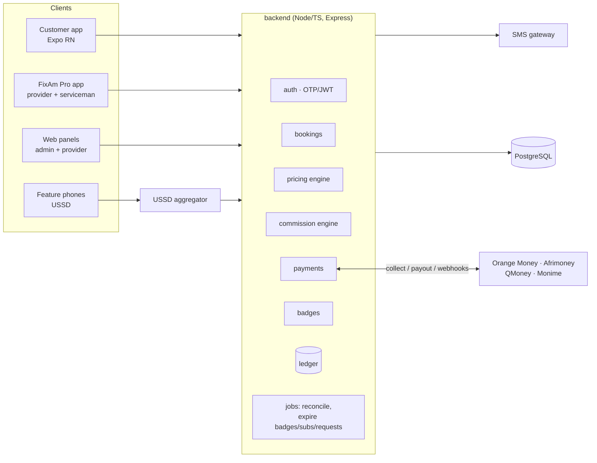
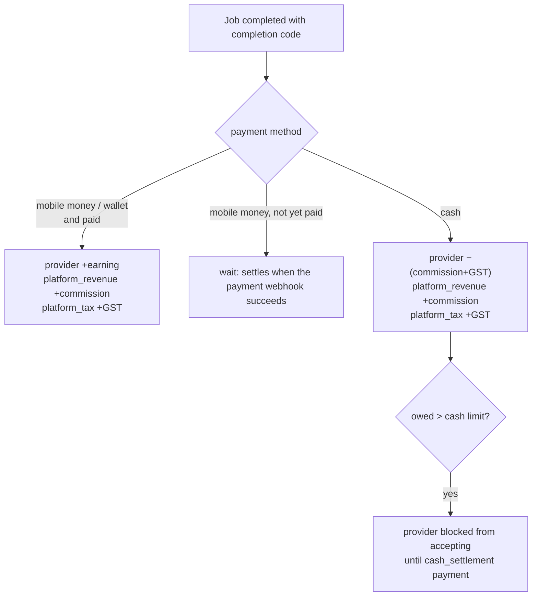

# FixAm Salone: architecture



Modules live in `backend/src/modules/<name>/`. Each has `*.routes.ts` (HTTP + validation) and `*.service.ts` (DB + business rules). The three rule engines (`pricing.engine.ts`, `commission.engine.ts`, the badge criteria) are **pure functions**: the same code serves live requests, admin simulators and unit tests.

## Money model

- All amounts are integer minor units of SLE (`bigint`, parsed to JS numbers).
- `ledger_entries` is an append-only signed journal per account:
  - `provider:<id>`: earnings wallet. A negative balance means commission owed on cash jobs.
  - `customer:<id>`: FixAm wallet (top-ups, refunds, wallet payments).
  - `platform_revenue`: commission, subscription fees and payout fees, net of GST.
  - `platform_tax`: GST payable on commission and subscriptions.
- Balance = `SUM(amount_minor)`. Balance-changing operations take a per-account advisory lock inside the transaction. A partial unique index makes settling a booking twice impossible.

### Settlement of a completed job



Disputes resolved with a refund post `settlement_reversal` entries that cancel the original ones, then credit the customer's wallet.

## Peak-hour pricing

`computePrice(input, rules, guardrails)`:

1. **Match** each active rule against the job's zone, category (and parent category), Freetown wall-clock time and date, urgency, and the zone's demand ratio. The demand ratio is open requests within ±2 h divided by available providers for that trade.
2. **Combine.** The best non-stackable rule wins on priority, then multiplier. Stackable rules (urgent, high demand) multiply on top and add flat fees.
3. **Guard.** Cap the multiplier (`pricing.max_multiplier`, default 1.75×) and the absolute surcharge (`pricing.max_surcharge_minor`).
4. **Round** to whole Leones and return customer-facing labels.

`POST /pricing/quote` persists the result as a **quote valid for 15 minutes**. A booking must consume an unexpired, unused quote, so the customer pays exactly what they were shown. `GET /pricing/day-curve` prices every hour of a day so the apps can nudge people towards off-peak slots. That spreads demand, which is the point of peak pricing when supply is fixed.

Seeded rules:

| Rule | Window | Effect |
|---|---|---|
| Weekday evening peak | Mon–Fri 17:00–21:00 | ×1.25 |
| Saturday rush | Sat 08:00–14:00 | ×1.15 |
| Night call-out | 21:00–06:00 | ×1.5 + Le 50 |
| Urgent job (stackable) | customer chose ASAP | ×1.2 + Le 100 |
| High demand (stackable) | demand ratio ≥ 2 | ×1.2 |
| Holiday rate | 27 Apr, 24 Dec–1 Jan | ×1.3 |
| Rainy season | Jun–Sep, roofing / plumbing | ×1.2 / ×1.1 |
| Hot season | Mar–May, AC & fridge | ×1.15 |

## Commission

`computeCommission` resolves one rate, in this order:

1. The provider's negotiated override.
2. The plan's subscription rate, while the subscription is active (subscription and hybrid plans).
3. The plan's rate for the job's category.
4. The 30-day GMV volume tier.
5. The plan's default rate.

The peak surcharge can use a separate, lower `surcharge_rate_bps`, so peak money mostly goes to the people working peak hours. Minimum and maximum commission apply, and commission is capped at the job total.

GST is 15% of commission. It is either added on top and deducted from the provider (`gst_borne_by=provider`), or treated as inside the commission (`platform`). The provider-bears mode always satisfies `earning + commission + GST = total`, which is unit-tested across many amounts.

Seeded plans:

| Plan | Model | Fee | Rate |
|---|---|---|---|
| Pay per job (default) | commission | n/a | 15%; 12.5% above Le 20k GMV/30 d; 10% above Le 50k. Cleaning and solar 12%. 10% on peak surcharge. Minimum Le 10. |
| Growth | hybrid | Le 250 / 30 d | 8% |
| Pro | subscription | Le 750 / 30 d | 0% |

When a subscription expires (background job), the provider falls back to the plan's default rate. Renewing early extends from the current end date.

## Mobile money

```mermaid
sequenceDiagram
  participant App
  participant API
  participant GW as Operator (Orange/Afrimoney/QMoney/Monime)
  App->>API: POST /payments (Idempotency-Key)
  API->>API: amount from booking/plan/balance · wallet↔SIM check
  API->>GW: initiateCollection
  GW-->>API: externalRef + customer action
  API-->>App: pending + "enter your PIN" / payment code
  GW-->>App: PIN prompt on the handset
  GW->>API: webhook (signed) → verify, de-dupe, apply once
  App->>API: GET /payments/:id (poll; also asks the gateway)
  API-->>App: succeeded → booking paid / wallet credited / subscription active
```

- `MobileMoneyGateway` interface: `initiateCollection`, `checkStatus`, `parseWebhook`, `initiatePayout`.
- `PAYMENT_MODE=sandbox` (default) simulates every operator, with deterministic test numbers (`…000` declines, `…999` never approves). `POST /payments/:id/simulate` sends a correctly signed webhook through the real handler, so the sandbox exercises the production code path.
- `PAYMENT_MODE=live` uses:
  - `OrangeWebPayGateway`, following Orange's published OM WebPay flow (OAuth token → `/webpayment` → `notif_token` callback). Orange Sierra Leone must confirm availability and issue the exact endpoints and fields.
  - `HttpMerchantGateway`, an adapter template for Afrimoney, QMoney and Monime. Their merchant API specs are issued at onboarding, so the request and response mapping in that file must be filled in from those specs. It does not claim to be their API today.
- State machine: `initiated → pending → succeeded | failed | expired`, then `refunded`. Final states are immutable; late or duplicate callbacks are logged and ignored.
- A reconciliation job polls payments still pending after 30 s and expires them after 15 min.

## Badges

- **Verification badges** need documents uploaded to private storage. An admin reviews them, a rejection requires a note, and the provider gets an SMS either way. Badges carry an expiry (ID 2 years, police clearance 1 year, business registration 1 year) and can be revoked; everything is audit-logged.
- **Performance badges** are re-evaluated after every completion, review and provider cancellation. They are granted and withdrawn automatically.
- Each badge has a public **verification code** (`FXB-XXXXXX`). Anyone can check it via `GET /badges/verify/:code` or USSD menu 3, and the check returns only what's needed to recognise the person.
- `trust_score` = the sum of valid badge weights, used for search ranking. `badges.required_to_accept_jobs` (default `NATIONAL_ID`) gates accepting work.

## Background jobs (`jobs/scheduler.ts`, every 60 s)

- Reconcile pending payments.
- Expire time-limited badges and recompute trust scores.
- Expire subscriptions.
- Auto-cancel stale open requests, refunding any prepayment to the customer's wallet.

Run them in the API process (default), or set `RUN_JOBS=false` and run `npm run jobs` from cron.

## Security notes

- OTPs are HMAC-hashed with attempt limits and per-number rate limiting. Refresh tokens are hashed and rotated on use.
- Booking start and completion codes are HMAC-derived, never stored, and compared in constant time.
- Webhook signatures use HMAC-SHA256 with a timestamp, a 5-minute tolerance and constant-time comparison.
- Payment amounts are computed server-side; the only client-supplied amount is a wallet top-up.
- Uploaded ID documents are private (owner or admin only, `no-store`).
- The USSD endpoint trusts `phoneNumber`, so it must be locked to the aggregator (`USSD_SHARED_SECRET` and/or an IP allow-list).
- Still to do before production: global rate limiting, an admin staff RBAC, object storage with encryption for documents, structured logging and alerts.
